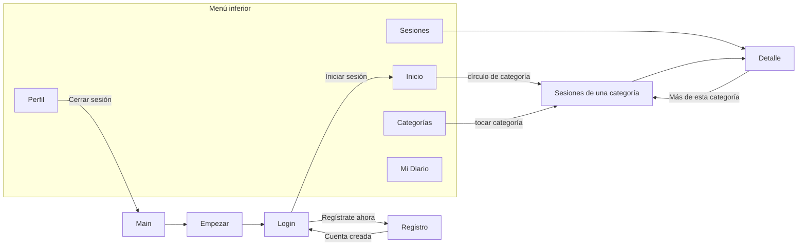

# Serena 🧘‍♀️

App Android de meditación y bienestar hecha con **Kotlin + Jetpack Compose**.
Proyecto del curso **Aplicaciones Móviles para Android** (ISIL, 2026-20).

**Autora:** Mabel Nayeli Rima Castro Vidarte

| | |
|---|---|
| Interfaz | Jetpack Compose + Material 3 (colores y fuente Poppins tomados de la plantilla Affan) |
| Arquitectura | MVVM: `models` → `data` (remote / repository / local) → `ViewModel` + `UIState` → pantallas |
| Servicio web | PHP + MySQL en AlwaysData, consumido con Retrofit 3 + Gson |
| Imágenes remotas | Coil 3 (`SerenaImagenRemota`) |
| Modo oscuro | Sí (`SerenaAppTheme` con esquema claro y oscuro) |

---

## PA3: componentes reutilizables

Todos los componentes están en `ui/components/`. Ninguno tiene colores ni medidas escritos a mano:
todo sale de `MaterialTheme.colorScheme` y de `AppTheme.spacing` / `AppTheme.sizes`.

**`SerenaBoton` es el componente que se reutiliza en las 10 pantallas.**

| Componente | Qué hace | Pantallas donde se usa |
|---|---|---|
| **SerenaBoton** | Botón de la plantilla en 3 estilos: `AMARILLO`, `AZUL`, `CONTORNO`; con icono opcional | **Main, Empezar, Login, Registro, Inicio, Categorías, Sesiones, Detalle, Mi Diario, Perfil** (10/10) |
| SerenaCard | Tarjeta redondeada; puede ser tocable y mostrarse seleccionada | Inicio, Categorías, Sesiones, Detalle, Mi Diario, Perfil |
| SerenaEncabezado | Barra superior con logo o con flecha de volver | Inicio, Categorías, Sesiones, Detalle, Mi Diario, Perfil |
| SerenaBarraNavegacion | Menú inferior de 5 secciones | Inicio, Categorías, Sesiones, Mi Diario, Perfil |
| SerenaInput | Campo de texto claro u oscuro, contraseña con "ojito", multilínea y mensaje de error | Login, Registro, Sesiones (buscador), Mi Diario, Perfil |
| SerenaModal | Ventana emergente de 1 o 2 botones (sus botones son `SerenaBoton`) | Login, Registro, Detalle, Mi Diario, Perfil |
| SerenaCargando / SerenaError / SerenaVacio | Los estados de una pantalla que espera datos del servidor | Inicio, Categorías, Sesiones, Detalle, Mi Diario |
| SerenaImagenRemota | Imagen del servidor con Coil y placeholder | Categorías, Sesiones, Detalle |
| SerenaEtiqueta | Chip para datos cortos (categoría, nivel, duración, "Destacada") | Categorías, Sesiones, Detalle |
| SerenaTituloSeccion | Título de bloque con enlace opcional ("Ver todas") | Inicio, Mi Diario, Perfil |

Cada componente tiene su `@Preview` para verlo en Android Studio sin ejecutar la app.

---

## Pantallas y navegación

10 Activities, todas conectadas entre sí:



| # | Pantalla | Archivo | Qué muestra |
|---|---|---|---|
| 1 | Main | `MainActivity.kt` | Portada con logo y botón Empezar |
| 2 | Empezar | `EmpezarActivity.kt` | Onboarding de la plantilla |
| 3 | Login | `LoginActivity.kt` | Usuario y contraseña; avisa si faltan datos |
| 4 | Registro | `screens/registro/` | 4 campos con validación y modal de confirmación |
| 5 | Inicio | `DashboardActivity.kt` | Banner, categorías del servidor, acceso a Mi Diario |
| 6 | Categorías | `screens/categorias/` | Las 6 categorías con imagen remota (maestro) |
| 7 | Sesiones | `screens/meditaciones/` | Sesiones con buscador y destacada; filtradas por categoría (detalle) |
| 8 | Detalle | `screens/meditaciones/MeditacionDetalleActivity.kt` | Imagen grande, duración, nivel, instructor y descripción |
| 9 | Mi Diario | `screens/diario/` | Ánimo del día, entrada de texto y lista de entradas (guardadas en el celular) |
| 10 | Perfil | `screens/perfil/` | Datos del usuario, estadísticas del diario, edición y cierre de sesión |

**Menú inferior:** el Inicio siempre queda en el fondo de la pila y las otras secciones se reemplazan
entre sí (`navegacion/Navegacion.kt`), así el botón "atrás" del celular vuelve al Inicio.

---

## Estructura del proyecto

```
com.mabel.serenaapp
├── MainActivity, EmpezarActivity, LoginActivity, DashboardActivity
├── models/            Categoria, Meditacion, EntradaDiario, Animo
├── data/
│   ├── remote/        RetrofitClient (BASE_URL), CategoriasService, MeditacionesService
│   ├── repository/    CategoriasRepository, MeditacionesRepository
│   └── local/         PreferenciasSerena (SharedPreferences + Gson)
├── screens/
│   ├── categorias/    UIState, ViewModel, CategoriaItem, Activity
│   ├── meditaciones/  UIState, ViewModels, MeditacionItem, Activity, DetalleActivity
│   ├── registro/      RegistroActivity
│   ├── diario/        DiarioViewModel, DiarioActivity
│   └── perfil/        PerfilViewModel, PerfilActivity
├── navegacion/        Navegacion.kt (menú inferior)
├── ui/components/     Componentes reutilizables (PA3)
├── ui/theme/          Color, Type, Spacing, Theme
└── utils/             Validaciones (correo, fechas)
```

---

## Servicio web

- `https://mabelcastro.alwaysdata.net/serena/categorias.php`
- `https://mabelcastro.alwaysdata.net/serena/meditaciones.php` (acepta `?idcategoria=N` y `?idmeditacion=N`)

Base de datos `serena` con dos tablas relacionadas: `categorias` (6 filas) y `meditaciones` (33 filas, 10 columnas).
Los scripts y los PHP están en la carpeta [`servidor/`](servidor/LEEME.txt).

---

## Cómo ejecutarla

1. Abrir la carpeta en Android Studio y esperar el *Gradle Sync*.
2. Ejecutar en un emulador o celular con Android 12 (API 31) o superior, con internet.

---

## Historial de features

| Rama | Contenido |
|---|---|
| `feature/componentes-reutilizables` | Paquete `ui/components`, medidas del tema, iconos, Coil |
| `feature/mvvm-sesiones` | MVVM, Categorías, Sesiones, Detalle, Inicio con ViewModel, servidor con imágenes |
| `feature/registro-perfil-diario` | Registro, Perfil, Mi Diario y navegación completa del menú inferior |
